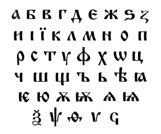

# O alfabeto cirílico russo
<figure class="imagem-alfabeto">
  
  <figcaption>Escrita cirílica antiga.</figcaption>
</figure>

O alfabeto russo tem 33 letras. Para cada uma, este capítulo indica o som equivalente em português, uma palavra russa de exemplo, como ela se lê e o que significa.

Na coluna "IPA", a pronúncia está escrita no Alfabeto Fonético Internacional, entre colchetes. O sinal ˈ vem antes da sílaba tônica. O texto fica encoberto: clique sobre ele para vê-lo. A tabela [Os símbolos do IPA](#os-simbolos-do-ipa), no fim desta página, explica cada símbolo.

## Três regras antes de começar

- **O átono soa como A.** Quando a letra **О** não está na sílaba tônica, ela soa como **a**. Por isso *вода́* (<Lat>[vɐˈda]</Lat> - água) se lê "va-dá", e não "vo-dá".
- **Algumas letras parecem latinas, mas não são.** В soa como V, Н soa como N, Р soa como R, С soa como S e Х soa como RR.
- **Г, Д e Т nunca mudam.** Г soa sempre como em "gato". Д soa sempre como em "dado". Т soa sempre como em "tatu". Os sons "dj" e "tch" do carioca não existem nessas letras.

## А – Д

| Letra | Som em português | Exemplo | IPA | Significado |
|---|---|---|---|---|
| **А а** | **a** de "casa" | ма́ма | [ˈmamə] | mãe |
| **Б б** | **b** de "bola" | банк | [bank] | banco |
| **В в** | **v** de "vaca" | вода́ | [vɐˈda] | água |
| **Г г** | **g** de "gato", sempre duro | газе́та | [ɡɐˈzʲetə] | jornal |
| **Д д** | **d** de "dado" | дом | [dom] | casa |

::: warning Armadilhas
**В** parece o nosso B, mas soa como **V**. **Д** nunca soa como "dj".
:::

## Е – И

| Letra | Som em português | Exemplo | IPA | Significado |
|---|---|---|---|---|
| **Е е** | **ié** de "Iémen" | нет | [nʲet] | não |
| **Ё ё** | **iô** de "iôiô", sempre tônica | ёлка | [ˈjɵɫkə] | pinheiro |
| **Ж ж** | **j** de "janela" | журна́л | [ʐʊrˈnaɫ] | revista |
| **З з** | **z** de "zero" | зима́ | [zʲɪˈma] | inverno |
| **И и** | **i** de "ilha" | мир | [mʲir] | paz; mundo |

::: info Observação
Depois de consoante, **Е** dá um leve som de "i" antes do "e": *нет* (<Lat>[nʲet]</Lat> - não) soa como "niet", não "net". No IPA, essa consoante amolecida leva o sinal ʲ.
:::

## Й – Н

| Letra | Som em português | Exemplo | IPA | Significado |
|---|---|---|---|---|
| **Й й** | **i** curto de "pai" | мой | [moj] | meu |
| **К к** | **k** de "casa" | кот | [kot] | gato |
| **Л л** | **l** de "lado" | ла́мпа | [ˈɫampə] | lâmpada |
| **М м** | **m** de "mão" | молоко́ | [məɫɐˈko] | leite |
| **Н н** | **n** de "navio" | нос | [nos] | nariz |

::: warning Armadilhas
**Н** parece um H, mas soa como **N**. Em молоко, só o último О é tônico. Os dois primeiros soam como **a**.
:::

## О – С

| Letra | Som em português | Exemplo | IPA | Significado |
|---|---|---|---|---|
| **О о** | **ó** quando tônico; **a** quando átono | молоко́ | [məɫɐˈko] | leite |
| **П п** | **p** de "pato" | па́па | [ˈpapə] | papai |
| **Р р** | **r** vibrado, como em "caro" | рот | [rot] | boca |
| **С с** | **s** de "sapo" | сок | [sok] | suco |
| **Т т** | **t** de "tatu" | там | [tam] | lá |

::: warning Armadilhas
**Р** parece um P, mas soa como **R** vibrado. Nunca soa como o "r" carioca de "rato".
**С** parece um C, mas soa sempre como **S**, mesmo entre vogais.
:::

## У – Ч

| Letra | Som em português | Exemplo | IPA | Significado |
|---|---|---|---|---|
| **У у** | **u** de "uva" | у́тро | [ˈutrə] | manhã |
| **Ф ф** | **f** de "faca" | фо́то | [ˈfotə] | foto |
| **Х х** | **rr** de "carro" (carioca) | хорошо́ | [xərɐˈʂo] | bom; bem |
| **Ц ц** | **ts** de "tsé-tsé" | у́лица | [ˈulʲɪtsə] | rua |
| **Ч ч** | **tch** de "tchau" | чай | [tɕæj] | chá |

::: warning Armadilhas
**У** parece um Y, mas soa como **U**. **Х** parece um X, mas soa como o **rr** gutural.
:::

## Ш – Ь

| Letra | Som em português | Exemplo | IPA | Significado |
|---|---|---|---|---|
| **Ш ш** | **ch** de "chave" | ша́пка | [ˈʂapkə] | gorro |
| **Щ щ** | **ch** mais longo e suave | борщ | [borɕː] | borscht (sopa) |
| **Ъ ъ** | sem som; separa a consoante da vogal seguinte | подъе́зд | [pɐdˈjest] | entrada do prédio |
| **Ы ы** | sem equivalente; um "i" com a língua recuada | сыр | [sɨr] | queijo |
| **Ь ь** | sem som; amolece a consoante anterior | день | [dʲenʲ] | dia |

::: info Observação
**Ъ** e **Ь** não são pronunciados. Eles só mudam o som da letra vizinha.
Em день, o Ь deixa o "n" final mais suave, parecido com um "nh" curto.
:::

## Э – Я

| Letra | Som em português | Exemplo | IPA | Significado |
|---|---|---|---|---|
| **Э э** | **é** de "café" | э́то | [ˈɛtə] | isto |
| **Ю ю** | **iu** de "Iugoslávia" | ю́бка | [ˈjupkə] | saia |
| **Я я** | **iá** de "Iara" | я́блоко | [ˈjabɫəkə] | maçã |

## Resumo: letras que enganam

| Parece | Mas soa como |
|---|---|
| В | V |
| Н | N |
| Р | R |
| С | S |
| У | U |
| Х | RR |

## Os símbolos do IPA

A pronúncia do caderno segue o Alfabeto Fonético Internacional. A maioria dos símbolos soa como a letra latina correspondente. Estes são os que pedem atenção:

| Símbolo | Como soa | Exemplo | IPA | Significado |
|---|---|---|---|---|
| ˈ | marca o início da sílaba tônica | молоко́ | [məɫɐˈko] | leite |
| ʲ | a consoante anterior é mole, com a língua no céu da boca, quase um "i" | нет | [nʲet] | não |
| ɐ | "a" fraco, logo antes da tônica ou no começo da palavra | вода́ | [vɐˈda] | água |
| ə | vogal neutra e muito curta, como o "e" final de "parte" no português europeu | ма́ма | [ˈmamə] | mãe |
| ɪ | "i" curto e relaxado, nas sílabas átonas | де́ти | [ˈdʲetʲɪ] | filhos |
| ɨ | o som do Ы: um "i" com a língua recuada | сыр | [sɨr] | queijo |
| ʊ | "u" curto e relaxado | купи́ть | [kʊˈpʲitʲ] | comprar |
| ɛ | "é" aberto | э́то | [ˈɛtə] | isto |
| ɵ | "ô" depois de consoante mole, quase um "ê" arredondado | всё | [fsʲɵ] | tudo |
| æ | "a" entre duas consoantes moles, quase um "é" | пять | [pʲætʲ] | cinco |
| ʉ | "u" entre duas consoantes moles | чуть | [tɕʉtʲ] | um pouco |
| ɫ | "l" duro, com a língua recuada, como o "l" final de "Brasil" em Portugal | ла́мпа | [ˈɫampə] | lâmpada |
| x | o Х: "rr" de "carro", raspado na garganta | хорошо́ | [xərɐˈʂo] | bem |
| ʂ | o Ш: "ch" de "chave", com a língua recuada | ша́пка | [ˈʂapkə] | gorro |
| ʐ | o Ж: "j" de "janela", com a língua recuada | журна́л | [ʐʊrˈnaɫ] | revista |
| ɕː | o Щ: "ch" longo e suave | борщ | [borɕː] | borscht |
| tɕ | o Ч: "tch" de "tchau" | чай | [tɕæj] | chá |
| ts | o Ц: "ts" de "tsé-tsé" | у́лица | [ˈulʲɪtsə] | rua |
| j | "i" curto de "pai" ou "iá" | я | [ja] | eu |
| ː | o som anterior é longo | А́нна | [ˈanːə] | Ana |

O caderno também mostra as mudanças que a escrita não mostra. No fim da palavra, a consoante perde a voz: *хлеб* (<Lat>[xlʲep]</Lat> - pão). Antes de outra consoante, ela se iguala à seguinte: *всё* (<Lat>[fsʲɵ]</Lat> - tudo), *вчера́* (<Lat>[ftɕɪˈra]</Lat> - ontem), *ло́дка* (<Lat>[ˈɫotkə]</Lat> - barco).
