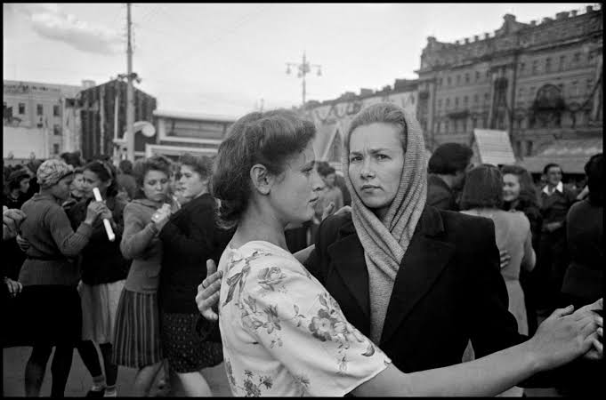

::: {.imagem-abertura}
{fig-alt="Fotografia em preto e branco de duas mulheres dançando juntas em uma praça, cercadas por outros pares e por prédios antigos. Uma delas, de lenço na cabeça, olha para a câmera."}
:::

Estas são as minhas notas de aprendizado da língua russa.

- [O alfabeto cirílico russo](alfabeto-cirilico.qmd): as 33 letras, com som, exemplo e pronúncia.
- [Pimsleur — Lição 01](pimsleur_russo_01.qmd): diálogo, conceitos, vocabulário e exercícios.
